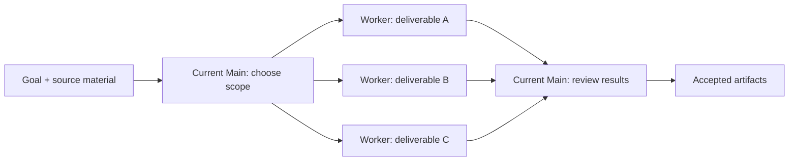

<div align="center">
  
  <h1>Codex Agents Workflow</h1>
  <p><strong>Turn a successful AI task into a workflow you can run again.</strong></p>

[](LICENSE)


[中文](README.zh-CN.md) · [Project & author's post](https://tgy233.top/tgypage/caw/) · [Workflow Package](https://github.com/TohmaN233/workflow-package)

</div>

A useful AI process often outgrows one prompt: gather the right material, split independent work, call existing tools, check the result, and finish the job. **Codex Agents Workflow makes that process visible and reusable inside Codex.** Start from a Skill or a plain-language brief, edit the graph, and run it with your configured Providers.

Your current Main conversation keeps the decisions and final acceptance. Workers receive the materials their steps need. The local Host handles scheduling, handoffs, tools, and recorded progress.


## One goal. Focused workers. A result you can inspect.

For a task with three independent deliverables, the process can look like this:



This is an illustrative graph. Real Workflows express dependencies, conditional routes, tools, and concurrency limits. Independent branches can run together; steps that need earlier results wait for them.

- **Reuse a process that already works.** Skill to Workflow converts instructions, references, and existing callable tools into an executable graph.
- **Build from a brief.** Describe the result and the steps you need; Build Workflow generates a graph for review and editing.
- **Give each step a focused context.** Declare its inputs, resources, predecessor results, and write scope.
- **Keep coordination in the Host.** It releases ready work, waits for events, and records attempts and outputs. Main makes the semantic decisions.
- **Repair the part that failed.** Inspect recorded progress and continue the affected work while keeping completed results available.

## Get started

Requires **Node.js 20+**, **Git**, and a Codex host supporting plugins and MCP Extensions.

### Installation

```sh
git clone https://github.com/TohmaN233/codex-agents-workflow.git
cd codex-agents-workflow
codex plugin marketplace add .
codex plugin add codex-agents-workflow@codex-agents-workflow
```

In a Codex task, open the workbench:

```text
Use $codex-agents-workflow:workflow-control-plane and open the workbench inside Codex.
```

1. Choose **Skill to Workflow** for an existing Skill, or **Build Workflow** for a new process.
2. Review the generated graph and its declared tools and dependencies. Automatic authoring publishes an enabled, launch-ready Workflow after review; the manual option keeps a reviewed Draft for your approval.
3. Choose **New task**, enter your goal, and follow the Run's progress and outputs.

Native Codex Providers are enabled by default. Configure optional external Providers in **Provider settings**. Enabled **Roles** can also help Main with ordinary tasks; Workflow nodes bind directly to Providers. See the [user guide](docs/guides/usage.md) for configuration and execution options.

## Install a reusable Workflow

Browse **[Workflow Package](https://github.com/TohmaN233/workflow-package)** for optional installable packages, source Skill credits, usage notes, comparison results, and complete output examples. Download the selected `*.workflow-package.json` and choose **Install Workflow** in the workbench.

The engine includes **Build Workflow** and **Skill to Workflow**. The package collection is maintained separately. Have a generally useful process to share? Contributions to the collection are welcome.

## Learn more

- [Documentation](docs/README.md) — setup, configuration, authoring, execution, and recovery.
- [Architecture](docs/architecture/overview.md) — how Main, workers, the Host, Skills, and the harness fit together.
- [Workflow format](docs/reference/README.md) — nodes, bindings, tools, and execution contracts.
- [Project & author's post](https://tgy233.top/tgypage/caw/) · [Author](https://github.com/TohmaN233) · [Repository](https://github.com/TohmaN233/codex-agents-workflow)

<details>
<summary>Contributing: verify the browser UI</summary>

Use Node.js 22+ in `plugins/codex-agents-workflow/control-plane`:

```sh
npm ci --ignore-scripts --no-audit --no-fund
npm run check:web
```

</details>

[MIT license](LICENSE) · [Security policy](SECURITY.md) · Version **1.2**
