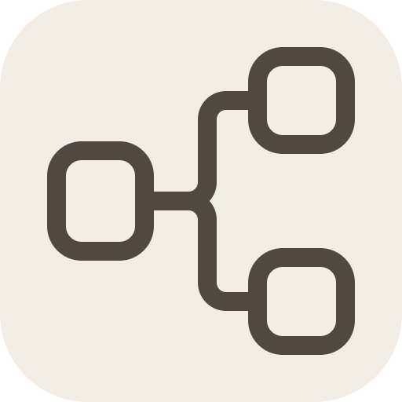
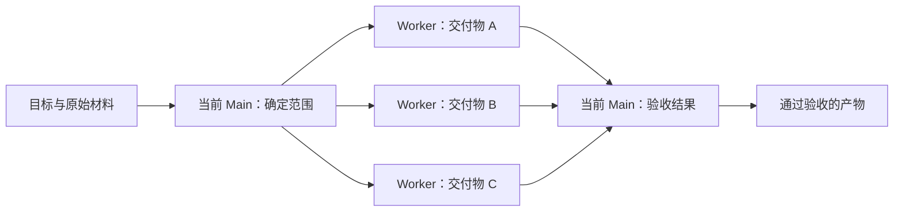

<div align="center">
  
  <h1>Codex Agents Workflow</h1>
  <p><strong>让 AI 的一次成功，成为可以再次运行的工作流。</strong></p>

[](LICENSE)


[English](README.md) · [项目与作者帖子](https://tgy233.top/tgypage/caw/) · [Workflow Package](https://github.com/TohmaN233/workflow-package)

</div>

一个有用的 AI 流程，往往不止一句提示词：准备材料、拆分独立工作、调用已有工具、检查结果，再完成交付。**Codex Agents Workflow 把这些步骤变成 Codex 中看得见、能复用的流程。** 从 Skill 或自然语言需求开始，编辑流程图，再用你配置的 Provider 运行。

当前 Main 对话负责决策和最终验收；各个 worker 获得自己这一步需要的材料。本地 Host 负责调度、交接、工具调用和进度记录。

**1.2.2** 将 worker 交接检查限定到明确声明的产物，保留原工具诊断与产物检查，避免渲染器状态目录变化造成误阻拦。控制台打开时提示版本更新，并提供 GitHub Star 入口；更新检查不会阻碍 Run。


## 一个目标，独立制作，统一验收

如果任务有三个彼此独立的交付物，流程可以这样组织：



这是一张示意图。实际 Workflow 可以表达依赖关系、条件分支、工具调用和并发上限。独立分支可以同时运行，需要前序结果的步骤则按依赖执行。

- **复用已经跑通的流程。** Skill to Workflow 将指令、参考资料和已有可调用工具转化为可执行的流程图。
- **从需求直接创建。** 描述目标和需要的步骤，Build Workflow 会生成可检查、可编辑的图。
- **给每一步合适的上下文。** 声明它需要的输入、资源、前序结果和写入范围。
- **把机械交接交给 Host。** Host 启动就绪节点、等待事件、记录尝试和产物，Main 负责语义判断。
- **修复失败的部分。** 查看已有进度，继续处理受影响的工作，保留已完成的结果。

## 开始使用

需要 **Node.js 20+**、**Git**，以及支持插件和 MCP Extensions 的 Codex 宿主。

### 安装

```sh
git clone https://github.com/TohmaN233/codex-agents-workflow.git
cd codex-agents-workflow
codex plugin marketplace add .
node plugins/codex-agents-workflow/scripts/install-local.mjs
```

依赖配置、LLM 自动安装步骤和验收方法见[安装说明](INSTALL.zh-CN.md)。

在 Codex task 中打开工作台：

```text
Use $codex-agents-workflow:workflow-control-plane and open the workbench inside Codex.
```

1. 已有 Skill，选择 **Skill to Workflow**；准备创建新流程，选择 **Build Workflow**。
2. 检查生成的图、声明的工具和依赖。默认在审查通过后发布已启用、可启动的 Workflow；手动模式会保留已审查的 Draft，等待你确认。
3. 选择 **新建任务**，输入目标，查看本次 Run 的进度和产物。

原生 Codex Provider 默认启用；需要外部 Provider 时，在 **Provider 设置**中配置。已启用的 **Role** 也可帮助 Main 处理普通任务；Workflow 节点直接绑定 Provider。配置与执行选项见[使用指南](docs/guides/usage.zh-CN.md)。

## 安装可复用的 Workflow

可选安装包统一放在 **[Workflow Package 仓库](https://github.com/TohmaN233/workflow-package)**，其中还有原 Skill 来源、使用说明、对照结果和完整产物样例。下载选中的 `*.workflow-package.json`，在工作台选择 **安装 Workflow**。

引擎内置 **Build Workflow** 和 **Skill to Workflow**，安装包集合独立维护。如果你有适合其他人复用的流程，也欢迎向集合仓库贡献。

## 进一步了解

- [文档索引](docs/README.zh-CN.md)：安装、配置、创建、运行与恢复。
- [架构说明](docs/architecture/overview.zh-CN.md)：Main、worker、Host、Skill 与 harness 如何协作。
- [Workflow 格式](docs/reference/README.zh-CN.md)：节点、绑定、工具与执行契约。
- [项目与作者帖子](https://tgy233.top/tgypage/caw/) · [作者](https://github.com/TohmaN233) · [仓库](https://github.com/TohmaN233/codex-agents-workflow)

<details>
<summary>参与开发：检查浏览器界面</summary>

使用 Node.js 22+，在 `plugins/codex-agents-workflow/control-plane` 中运行：

```sh
npm ci --ignore-scripts --no-audit --no-fund
npm run check:web
```

</details>

[MIT 许可证](LICENSE) · [安全策略](SECURITY.md) · 版本 **1.2**
