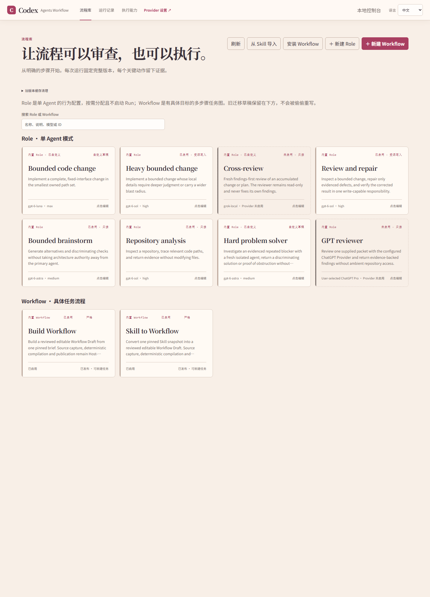
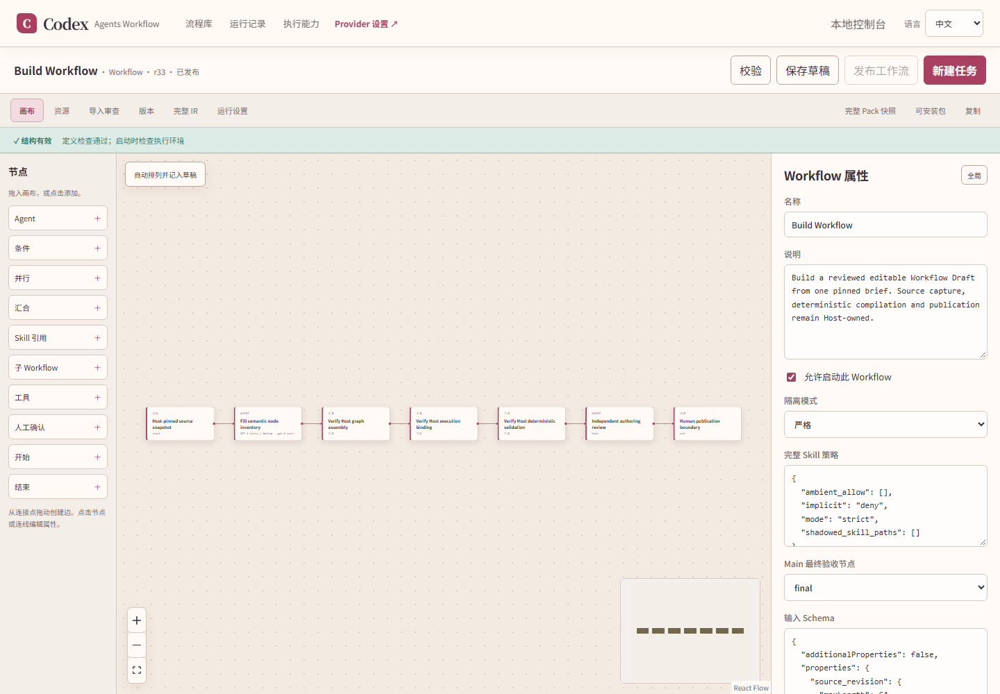

# Using Codex Agents Workflow

[README](../../README.md) · [中文教程](usage.zh-CN.md)

This guide covers the 1.2 workbench, its built-in Workflows, Provider and Role settings, optional packages, task execution, and recovery.

## 1. Install and open the workbench

Follow the [README installation steps](../../README.md#installation). After adding or updating the plugin, use the Codex host's plugin-catalog reload or reconnect action, then reopen the embedded workbench. Restart Codex only if the relevant reload is unavailable or demonstrably ineffective.

Open the workbench from its plugin entry, or ask in your current Codex task:

```text
Use $codex-agents-workflow:workflow-control-plane and open the workbench inside Codex.
```

The workbench and Provider settings are MCP App views. Opening a view does not start a Workflow and does not require a new task. Composer mentions, when available, can reference a Workflow or Role; a reference supplies context but does not authorize execution. Embedded features depend on the capabilities the host provides.

The embedded view needs no manually started HTTP server, port, or authentication URL. For a standalone browser page, or a host without embedded-view support, start the console from the clone:

```powershell
.\plugins\codex-agents-workflow\scripts\open-control-console.cmd
```

```sh
sh plugins/codex-agents-workflow/scripts/open-control-console.sh
```

The Windows launcher follows Codex's installed-plugin record. The macOS/Linux script starts the workbench from the current clone. Keep the terminal process running; do not share its tokenized loopback URL.

A fresh library contains only **Build Workflow** and **Skill to Workflow**. Roles appear in their own section.



## 2. Understand Providers, Roles, and Workflows

| Object | Purpose | Creates a Run |
| --- | --- | --- |
| Provider | Configures a model or other execution connection | No |
| Role | Defines how Main delegates one helper during an ordinary task | No |
| Workflow | Defines a task graph with steps, dependencies, and completion rules | Yes |

When no Ready Workflow matches a concrete request and a helper would materially help, Main can automatically select an enabled Role. The user does not need to name a Role or start a Workflow. This automatic Role selection is separate from Workflow execution: Workflow nodes bind directly to Providers and do not receive Workbench Role instructions.

Release defaults:

- Native Codex Providers are enabled; external Providers are disabled.
- Cross-review and GPT reviewer Roles are visible but disabled. Each also needs its Provider enabled before use.
- Build Workflow and Skill to Workflow are the only built-in Workflows.
- Optional packages are installed from the separate [Workflow Package collection](https://github.com/TohmaN233/workflow-package).

A disabled Provider is not silently replaced. A Workflow that depends on one may be installed or edited, but cannot start until its Provider is available.

## 3. Configure Providers and Roles

Open **Provider settings** from the workbench navigation or the plugin settings entry.

### Native Providers

Native Providers use the model catalog available to the current Codex login. After choosing a model, the UI lists its supported reasoning efforts. Main uses the calling chat's current model and reasoning selection; a standalone workbench launch follows Codex settings.

The current authoring presets distinguish task difficulty:

| Preset | Intended work |
| --- | --- |
| GPT-6 Luna / Max | Routine bounded inspection, documentation and implementation |
| GPT-6.1 Sol / High | Complex implementation, cross-module analysis and independent review |
| GPT-6 Astra / Medium | Difficult planning, novel causal diagnosis and unresolved design tradeoffs |

These are editable Provider routes. A read-only scan or ordinary audit does not by itself require a planning model. Generated independent workers default to Provider subagents with task-scoped write access; actual conversation decisions and orchestration use Main (orchestration). Main workers and persistent Threads are optional choices you make in the editor.

### External Providers

External Providers start disabled. Enable one only when needed, then configure its endpoint, model, and authentication. A session API key has a dedicated input rather than an ordinary saved configuration field. Saving settings does not call a model.

The GPT reviewer uses the existing `chatgpt-web-pro` Provider. Cross-review uses `grok-local`. Enable the Role and its Provider separately before using either one.

### Edit a Role

Click a Role in the library to change its enabled state, Provider binding, access level, or behavior instructions. Model and reasoning settings belong to the Provider. Roles apply to Main's ordinary helper delegation; Workflow nodes use their own Provider, task, inputs, and access.

## 4. Build a Workflow from a brief

Open **Build Workflow**, choose **New task**, and describe a reusable process rather than the answer to one temporary run. State its goal and artifacts, required ordering, work that can run independently, decisions that need human approval, required files or tools, and how to recognize completion or resume after failure.

The authoring process returns semantic steps. The Host builds the graph and checks its bindings, dependencies, and launch requirements.

By default, authoring completes only after independent review and Host checks establish a launch-ready Workflow. The Host cleans temporary authoring artifacts, publishes and enables the Workflow, then opens the complete graph in the canvas. To choose human acceptance, select **Keep a reviewed draft for my acceptance** before starting. That policy leaves the reviewed result as an editable draft for you to accept.

A structurally valid graph with unresolved launch or cleanup blockers is not a completed launch-ready result.

### Multilingual documentation

For documentation tasks, name the requested languages and the primary drafting language. For example:

```text
Build a documentation Workflow with English as the primary language and Chinese and Japanese versions.
Check the primary draft, translate it into both other languages, then verify that every requested document exists in all three languages.
Preserve commands, identifiers, numerical data and the author's links across versions.
```

Languages belong to the task or its Workflow input schema; the workbench's interface-language selector does not choose output languages. A monolingual task should skip translation. If only a language count is supplied, resolve the actual language choices before drafting.

## 5. Convert a Skill into a Workflow

Choose **Import from Skill** in the library:

1. Scan the default Codex Skill folders or choose the folder containing the Skill.
2. Verify its name, location, and source version, then select **Import this version**.
3. Open **Import review** and inspect the pinned source, resources, dependencies, and conversion status.
4. Start authoring, then inspect the generated nodes, edges, human gates, and source-requirement mappings in the full canvas.
5. Review the generated Workflow against the source Skill's rules and the real execution environment.

The same automatic launch-ready completion policy described above applies. Choose the draft option before starting if you want to review and accept the draft yourself.

Check that hard rules and acceptance criteria survived, only independent work runs in parallel, predecessor results reach the right nodes, approval occurs before external effects, required tools and permissions remain available, and machine-specific paths became Run inputs or portable dependencies.

Import does not modify the source Skill or execute its business task. Publishing the generated Workflow does not start a Run.

## 6. Install an optional Workflow

The [Workflow Package collection](https://github.com/TohmaN233/workflow-package) provides generally useful packages, currently Answer me with HTML and GitHub README generator. All explanations and examples are grouped under its `workflow_explanations/` directory. In the workbench, choose **Install Workflow** and select a `*.workflow-package.json` file. Installation checks format, content hashes, compatibility, and dependency declarations; it does not install missing software.

If an installed Workflow cannot start, check its declared local tools, node Providers, any required Role and Provider, and the inputs for this Run. Some example packages reference Cross-review. They can be installed while that Role is disabled, but require both the Role and a usable Provider before launch.

- **Full Pack snapshot** contains the complete editor revision and resources. It may include private conversion material and is useful for audit and diagnosis.
- **Install package** includes compatibility, dependency, and integrity manifests while excluding private source material. Use it to install a Workflow on another computer.

## 7. Edit, publish, and run

Opening a Workflow shows its canvas:



Add nodes from the left, edit connections in the canvas, and change Workflow or node properties on the right. The top tabs show resources, import review, versions, full IR, and Run settings.

### Set subagent count and concurrency

Select an **Agent node**, choose **Provider · native handoff** under **Execution mode**, then set its **Sub-Agent count**:

| Setting | Meaning |
| --- | --- |
| Auto | Uses one Agent without list fan-out; with fan-out, derives the count from the list and batch size |
| Fixed count (1–32) | Partitions the input list among that many Agents; there must be at least one item per Agent |
| `batch_size` | Items per batch (1–32); batching uses `distribution: "partition"` |
| `max_concurrency` | Maximum active batches (1–32), not the total batch count |
| `scheduling: "parallel"` | Runs batches in parallel, with `max_concurrency` limiting active batches |
| `scheduling: "serial"` | Releases the next batch after the previous result is recorded |

For Auto, enable **list fan-out**, then configure its distribution and scheduling fields in **Runtime fanout contract**. With 31 inputs, Auto, `distribution: "partition"`, `batch_size: 10`, `scheduling: "parallel"`, and `max_concurrency: 2`, the node creates four batches of at most ten items and runs at most two batches at a time. Match input bindings and result names to the node definition. Save, validate, and publish before starting a Run with changed settings.

Main nodes do not have this count control. A Thread continuation reuses one existing task; a Role delegates one helper. Configure list distribution on a Workflow node.

Codex also limits the number of subagents open in one session. In the existing `[agents]` section of user `~/.codex/config.toml` (Windows: `%USERPROFILE%\.codex\config.toml`) or project `.codex/config.toml`, set, for example:

```toml
[agents]
max_concurrent_threads_per_session = 8
```

This limit excludes Main and does not force every task to start eight Agents. Existing configurations may use the `max_threads` compatibility alias; do not set both. Workflow `max_concurrency` does not raise Codex's session limit. See the [official Codex subagent documentation](https://learn.chatgpt.com/docs/agent-configuration/subagents).

### Save and run

These actions have different results:

1. **Validate** checks the current definition and contracts.
2. **Save draft** stores edits without creating a launchable published revision.
3. **Publish workflow** pins a revision and checks launch blockers.
4. **New task** starts one Run from a published revision.

Structural validity does not mean the current machine meets every runtime dependency. Provider, tool, environment, and Run-input checks continue at launch.

Run settings can point to an existing project directory; leave the field empty for the Host to create a workspace. Keep machine-specific project paths out of reusable Workflows.

To run an installed, published Workflow from Codex:

```text
Use $codex-agents-workflow:workflow-control-plane.
Run the Workflow I installed from Workflow Package for this task.
Use the source material and goal I provided in this conversation.
```

If no matching published Workflow exists, Main should say so instead of inventing one or silently choosing another.

## 8. What happens during a Run

Main has two Workflow execution modes:

| Mode | Execution and context |
| --- | --- |
| Main (worker) | An optional fresh session using the initiating Main's model, with declared node inputs and resources. Legacy Main nodes without a mode retain this behavior. |
| Main (orchestration) | The actual initiating Main chat takes over the node and keeps its available conversation context. Start from that chat or the embedded workbench. |

An orchestration Main node is the initiating Main continuing the Workflow. It is distinct from a fresh Main worker session and from Main's automatic selection of a helper Role in an ordinary task. A standalone console cannot supply the initiating chat's context and reports that orchestration must start from a chat.

Workflow nodes and native subagents use node-scoped inputs. They do not automatically inherit the parent chat, ambient Skill folders, or other nodes' raw transcripts. The Host prepares paths, bindings, result schemas, and recovery records; nodes write artifacts in the assigned workspace and return short status and file locations. After a dependent handoff, the Host waits for events instead of making Main poll. Successful parallel batches remain available when another batch fails, so repair can focus on the failed items.

## 9. Native agents, Threads, and Run history

Ordinary independent work uses native Agents. A Thread is for a Workflow stage that must continue the same visible Codex task later. Its continuation refers to the exact recorded task identity; it does not create a replacement task or provide extra operating-system isolation. Threads preserve more conversation state and are not the default executor.

On Run startup, completed and failed history older than 24 hours is cleaned up. The Runs page also has a **Clean history** action for eligible finished records. Active, interrupted, paused, and unsettled work remains available, and workspace artifacts are not removed.

## 10. Recovery and connection troubleshooting

| Symptom | What to check |
| --- | --- |
| Workbench or plugin tools are missing after install/update | Use the host's plugin-catalog reload or MCP reconnect action, then reopen the workbench and call a plugin tool in the intended session. Restart Codex only if that reload is unavailable or demonstrably ineffective. |
| A tool call still fails after reopening the view | Inspect the plugin user-data `mcp-startup.jsonl` log and Codex host startup logs. Refreshing the Skill catalog alone does not reconnect MCP. |
| A Role says its Provider is disabled | Enable its Provider and the Role separately, or bind the Role to an available Provider. |
| An installed Workflow cannot start | Check the launch blockers, node Providers, declared tools, dependencies, and Run inputs. |
| Authoring stops | Read the explicit error and Run record; check the Codex login, selected models, dependency requirements, and Host startup logs. |
| A child Agent does not advance | Check whether the Run is waiting, failed, or needs attention; let the Host's event wait resume it. |
| The page disconnected while a Run continues | Reopen the Runs page and recover the existing Run; reconcile its recorded state and actual artifacts before continuing. |

Do not treat opening the App as proof of a live MCP connection. Verify recovery with a successful plugin tool call in the session that will execute the work. Ask Codex to recover the existing Run, check its recorded nodes and local artifacts, then continue from the unfinished steps. Recovery does not rerun successful nodes or approve human gates automatically.

## 11. Update

Update the local clone:

```sh
git pull --ff-only origin main
```

After pulling, reinstall the local plugin on Windows:

```powershell
node plugins/codex-agents-workflow/scripts/install-local.mjs
```

Use the host's plugin-catalog reload or reconnect action and reopen the embedded workbench. Restart Codex only if the relevant reload is unavailable or demonstrably ineffective. For a CLI task, reconnect its MCP session and verify a real plugin tool call in that session. Opening the workbench does not require creating another task.

Workflow definitions, Role customizations, Provider settings, and Run records are stored in the user-level Codex configuration directory.
